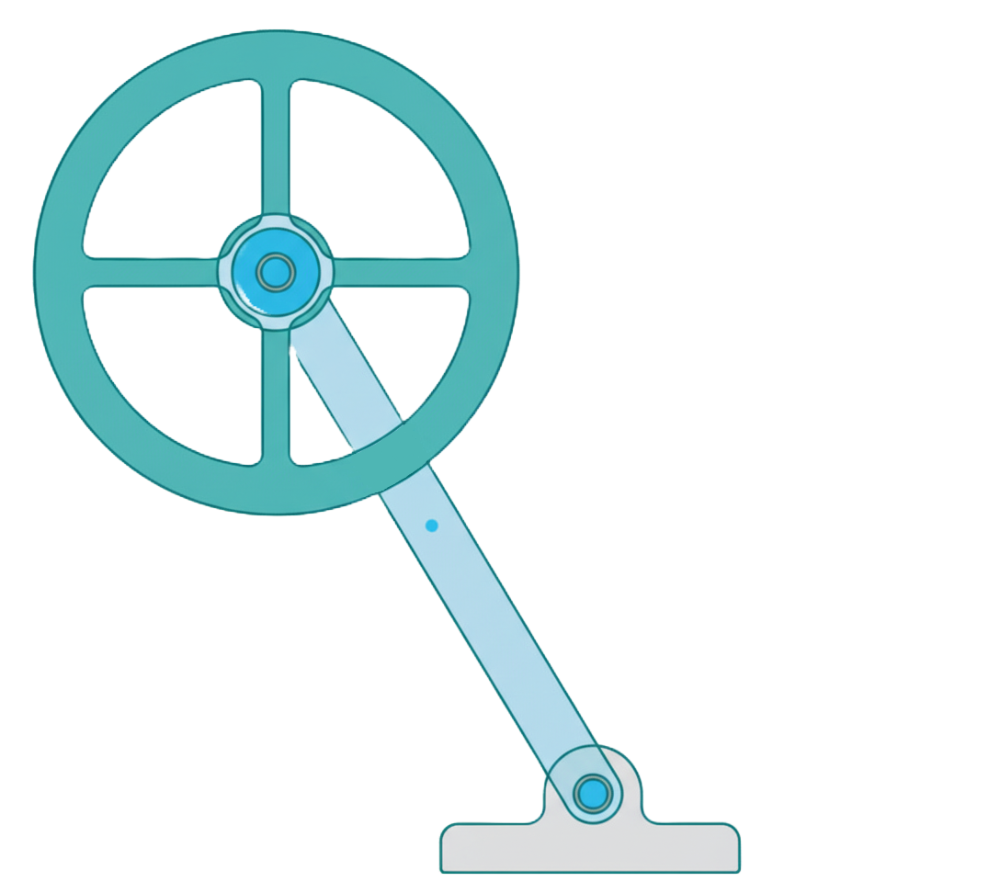

# Reaction Wheel Balancing Robots: From 1D Pendulum to 3D Cubli

  

## 1. Project Overview
This repository documents an academic exploration into the dynamics and control of inherently unstable systems, specifically focusing on reaction wheel-based inverted pendulums. The project is structured in progressive stages, beginning with the design and stabilization of a single-axis pendulum and aiming to culminate in the development of a full three-axis balancing cube (a "Cubli").
The primary goal is to provide a comprehensive study of the practical application of control theory, from fundamental state estimation and sensor fusion to the implementation of a robust PID control law on a real-world hardware platform.
## 2. Project Goals
- Implement State Estimation: Develop a robust algorithm to determine the robot's orientation angle by fusing noisy accelerometer data and drifting gyroscope data from an IMU.

- Design a PID Controller: Implement and tune a Proportional-Integral-Derivative (PID) controller to provide the corrective torque necessary to maintain balance.

- Explore Unstable Systems: Gain practical experience in stabilizing a classic "unstable plant" problem in control engineering.

- Create a Scalable Platform: Build a hardware and software foundation that can be extended from a 1-axis system to a more complex 3-axis system.

## 3. Current Status
- Single-Axis Inverted Pendulum
Status: Complete and functional
Description: The hardware has been assembled, and the firmware successfully stabilizes the pendulum in its vertical position. The control code includes full sensor calibration, a complementary filter for sensor fusion, and a live-tunable PID controller with anti-windup logic.
[View the Detailed Technical Report and Code for the 1-Axis Pendulum](https://github.com/DanialRezaei/Reaction-Wheel-Balancing-Robots/tree/main/Single-Axis%20Reaction%20Wheel%20Inverted%20Pendulum%20(V1.0))
- Three-Axis Cubli:
Status: Future Work / Planned.
Description: This stage will extend the principles learned from the 1-axis version to control a cube balancing on a single corner, requiring a more advanced 3D state estimation (likely using quaternions) and a multi-input, multi-output (MIMO) control system.
## 4. Technology Stack (1-Axis Pendulum Version)
Microcontroller: Arduino Mega 2560
Programming Language: C++ (Arduino Framework)
Primary Sensor: MPU6050 6-DoF IMU
Actuator: DC Motor with Flywheel
Motor Driver: BTS7960 H-Bridge
