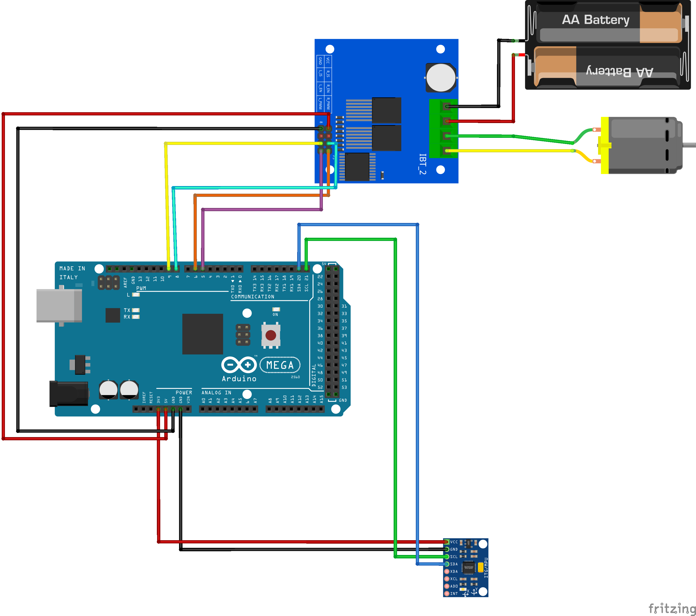

This readme provides a detailed technical guide to the **software implementation and control theory** for a single-axis reaction wheel balancing robot. It focuses on the firmware developed for an Arduino Mega, covering key topics such as state estimation from an MPU6050 IMU, sensor fusion using a complementary filter, and the implementation of a PID control law to achieve stable balance.
# Table of Contents
[1. Overview](#1-Overview)
[[# 1. Overview]]
[[#2. Hardware and System Architecture]]
	[[#2.1. Component List]]
	[[#2.2. System Schematic]]
	[[#2.3. Component Roles]]
[[#3. Control Theory and Principles]]
	[[#3.1. The Inverted Pendulum Problem]]
	[[#3.2. Actuation via Reaction Wheel]]
	[[#3.3. State Estimation via IMU]]
	[[#3.4. Sensor Fusion The Complementary Filter]]
	[[#3.5. The PID Controller]]
[[#4. Software Implementation]]
	[[#4.1. Program Structure]]
	[[#4.2. Sensor Initialization and Calibration (angle_setup())]]
	[[#4.3. Real-time Angle Calculation (angle_calc())]]
	[[#4.4. PID Control Logic]]
	[[#4.5. Motor Control (Motor_control())]]
[[#5. Operating Procedure]]
	[[#5.1. Calibration Sequence]]
	[[#5.2. Live PID Tuning]]
# 1. Overview
This project implements a single-axis inverted pendulum that actively balances itself using a reaction wheel. An inverted pendulum is an inherently unstable system, making it a classic problem in dynamics and control theory. The goal is to maintain the pendulum's body in a vertical, upright position (the unstable equilibrium point) by precisely controlling the angular acceleration of a flywheel.
This document serves as a complete technical reference, detailing the physical hardware, the underlying control theory, and the specific software implementation used to achieve stable balance.
# 2. Hardware and System Architecture
## 2.1. Component List
- **Microcontroller:** Arduino Mega 2560
- **Inertial Measurement Unit (IMU):** MPU6050 6-DoF Accelerometer + Gyroscope
- **Motor Driver:** BTS7960 High Current H-Bridge
- **Actuator:** DC Motor coupled with a Flywheel
- **Power Supply:** External DC power source for the motor (e.g., batteries)
## 2.2. System Schematic
The components are interconnected as shown in the schematic below. The Arduino serves as the central processing unit, reading sensor data via I2C and sending PWM control signals to the motor driver.

## 2.3. Component Roles
- **Arduino Mega:** The brain of the system. It executes the control loop, which involves reading sensor data, calculating the orientation angle, computing the necessary corrective action via a PID algorithm, and sending PWM signals to the motor driver.
- **MPU6050 IMU:** The primary sensor for determining the state of the pendulum. It provides raw acceleration and angular velocity data, which is fused to produce a stable estimate of the pendulum's tilt angle.
- **BTS7960 Motor Driver:** A high-power H-bridge that acts as an interface between the Arduino's low-current logic signals and the high-current demands of the DC motor. It allows for precise control over the motor's speed and direction.
- **DC Motor + Flywheel:** The system's actuator. By changing the angular velocity of the flywheel, a reaction torque is generated and applied to the pendulum's body, allowing it to counteract the force of gravity.
# 3. Control Theory and Principles
## 3.1. The Inverted Pendulum Problem
An inverted pendulum is a classic example of an unstable dynamic system. Its center of mass is located above its pivot point, meaning any deviation from the perfectly vertical equilibrium position will result in a gravitational torque that causes it to fall. The objective of the control system is to actively counteract this torque to maintain balance.
## 3.2. Actuation via Reaction Wheel
The system's ability to balance is governed by the principle of **conservation of angular momentum**, a direct consequence of Newton's Third Law.
When the controller commands the motor to apply a torque ($T$) to the flywheel, causing it to accelerate with an angular acceleration ($\alpha$), the flywheel exerts an equal and opposite reaction torque ($−T$) on the body of the pendulum.
> `Mathematical Principle`
> **Torque1:**
> $T=I⋅α$
> Where:
> - $T$ = Torque    
> - $I$ = Moment of inertia of the flywheel
> - $α$ = Angular acceleration of the flywheel
This reaction torque is used to counteract the gravitational torque and push the pendulum back to its vertical setpoint.
## 3.3. State Estimation via IMU
To apply the correct torque, the controller must first have an accurate estimate of the pendulum's current state, specifically its tilt angle. The MPU6050 provides two sensors for this purpose.
- **Accelerometer (Static Tilt Sensing):** The accelerometer measures the static gravitational vector. By resolving this vector into its components on the sensor's axes, a tilt angle can be derived using trigonometric functions. This method provides a stable, long-term reference for which way is "down." However, it is highly susceptible to noise from vibration and linear acceleration, making it unreliable during dynamic conditions.
- **Gyroscope (Angular Rate Sensing):** The gyroscope measures angular velocity (rate of rotation). The angle can be obtained by performing a **numerical integration** of this rate over time. This provides a clean, responsive signal that is immune to linear acceleration. However, due to inherent sensor bias, this integration process accumulates error, causing the angle estimate to **drift** significantly over time.
## 3.4. Sensor Fusion: The Complementary Filter
Since neither sensor is sufficient on its own, their data must be fused. A **complementary filter** is a computationally efficient algorithm that combines the best characteristics of both sensors. It is a steady-state approximation of a more complex Kalman filter.
> `Mathematical Principle`
> **Complementary Filter:**
> $$\theta_{new}​=\alpha \cdot(\theta_{old​}+\omega_{gyro}​\cdot dt)+(1−\alpha)\cdot\theta_{accel}​$$
> Where:
> - $\alpha$ is the filter coefficient (e.g., 0.95), determining the trust in the gyroscope.  
> - The term $\theta_{old​}+\omega_{gyro}​\cdot dt$ represents the **Euler integration** of the gyroscope rate, forming the high-pass filter component.
> - $\theta_{accel}$ is the angle from the accelerometer, forming the low-pass filter component.

The filter primarily trusts the integrated gyroscope reading for its responsiveness while using a small amount of the stable accelerometer data to correct for the gyro's long-term drift.
## 3.5. The PID Controller
The Proportional-Integral-Derivative (PID) controller is the core of the decision-making process. It calculates the necessary motor output (torque) required to bring the pendulum's angle back to the desired setpoint (0 degrees).
> `Mathematical Principle`
> **PID Control Law (Discrete-Time):** 
> $$u(t)=K_p​e(t)+K_i​\Sigma_{i=0}^{t}​e(i)\Delta t+K_d​ \frac{e(t)−e(t−1)}{\Delta t}$$​
> Where:
> - $u(t)$ is the controller output.
> - $e(t)$ is the error (setpoint - current angle).
> - $K_p​, \ K_i​, \ K_d$​ are the proportional, integral, and derivative gains.
> - $\Delta t$ is the fixed time step of the loop.
- **Proportional ($K_p$):** The primary acting force. It provides an output proportional to the **current error**. This is the "muscle" of the controller.
- **Integral ($K_i$):** Corrects for past, accumulated errors. It is used to eliminate small, persistent steady-state errors. A key challenge is preventing **integral windup**, where the accumulated sum becomes excessively large and destabilizes the system.
- **Derivative ($K_d$):** Predicts future errors based on the rate of change. This provides a damping force, smoothing the response and preventing overshoot. It acts as the "brakes."
# 4. Software Implementation
The provided Arduino code implements the above principles in a fixed-time-step control loop.
## 4.1. Program Structure
The code is divided into a `setup()` function for one-time initialization and a `loop()` function that executes the main control cycle. To ensure deterministic behavior, the `loop()` is regulated by `micros()` to maintain a consistent frequency (200Hz, or one cycle every 5000 microseconds). A fixed time step (`dt`) is crucial for the stability and accuracy of both the sensor fusion filter and the PID controller.
## 4.2. Sensor Initialization and Calibration (`angle_setup()`)
This function handles the initial configuration of the MPU6050 by communicating directly with its registers via I2C.
1. **Direct I2C Communication:** Helper functions `i2cWrite` and `i2cRead` are defined to directly manipulate the MPU6050 registers.
2. **Configuration:** The code wakes the sensor up (`PWR_MGMT_1`) and configures the accelerometer and gyroscope to specific ranges (`ACCEL_CONFIG` and `GYRO_CONFIG`).
3. **Gyro Calibration:** To counteract drift, the code reads the gyroscope's Z-axis 2000 times while the robot is held stationary. The average of these raw readings is stored as `gyro_offset` and is subtracted from all future gyro readings.
    ``` cpp
    // Snippet from angle_setup()
    long sum = 0;
    const int Ngyro = 2000;
    for (int i = 0; i < Ngyro; i++) {
        while (i2cRead(0x3B, i2cData, 14));
        int16_t gz = (int16_t)((i2cData[12] << 8) | i2cData[13]);
        sum += (long)gz;
        delay(2);
    }
    gyro_offset = (float)sum / (float)Ngyro;
    ```
4. **Accelerometer Calibration:** To define the vertical "zero" point, the code takes 500 readings while the robot is held in its desired balancing position. The average angle is stored as `accel_offset`.
## 4.3. Real-time Angle Calculation (`angle_calc()`)
This function is called in every loop to update the state estimate.
1. **Static Tilt Sensing (Accelerometer):** The raw accelerometer values for the X and Y axes are read. The `atan2(AcX, AcY)` function is used to resolve the gravity vector into an angle. This specific formula was determined empirically based on the physical mounting of the sensor. The `accel_offset` is then applied.
    ``` cpp
    // Snippet from angle_calc()
    float accel_angle = atan2((float)AcX, (float)AcY) * 180.0f / PI + accel_offset;
    ```
2. **Low-Pass Filter (Gyro):** A simple low-pass filter is applied to the raw gyro rate. This is critical because the PID controller's derivative term is highly sensitive to noise. The filtered `gyroZfilt` provides a smooth, less noisy rate-of-change signal for the Kd term.
    ``` cpp
    // Snippet from angle_calc()
    gyroZfilt = gyro_lpf_alpha * gyro_rate + (1.0f - gyro_lpf_alpha) * gyroZfilt;
    ```
3. **Euler Integration and Fusion:** The final fused angle is calculated. The `angle + gyro_rate * dt` term is a first-order **Euler integration** of the angular velocity.
    ``` cpp
    // Snippet from angle_calc()
    angle = K_comp * (angle + gyro_rate * dt) + (1.0f - K_comp) * accel_angle;
    ```
## 4.4. PID Control Logic (in `loop()`)
1. **PID Calculation:** The controller output `raw_u` is calculated. The error term is the `angle`. The filtered gyro rate `gyroZfilt` serves as the derivative of the angle.
    ``` cpp
    // Snippet from loop()
    raw_u = -(Kp * angle + Kd * gyroZfilt + Ki * integral);
    ```
2. **Anti-Windup (Clamping):** An anti-windup scheme known as **clamping** or **conditional integration** is implemented. The integral term is only updated if the _next potential output_ (`u_test`) is not saturated. This prevents the integral sum from growing uncontrollably when the actuator is at its physical limit, a primary cause of instability after large disturbances.
    ``` cpp
    // Snippet from loop()
    float integral_candidate = integral + angle * dt;
    float u_test = -(Kp * angle + Kd * gyroZfilt + Ki * integral_candidate);
    if (abs(u_test) <= 255.0f) integral = integral_candidate;
    ```
3. **Deadband:** A small deadband around the setpoint is implemented to prevent the motor from constantly oscillating ("hunting") when the robot is balanced.
## 4.5. Motor Control (`Motor_control()`)
This function translates the final PID output into the appropriate signals for the BTS7960 driver. A `REVERSE_MOTOR` flag is included to easily invert the motor's corrective direction.
# 5. Operating Procedure
## 5.1. Calibration Sequence
Upon startup, the robot must be kept **perfectly still on a flat surface** for the gyroscope calibration. After this, the prompt "Calibrating accel: hold vertical..." will appear. The user must then **hold the robot in its desired vertical balancing position** for a few seconds to complete the accelerometer calibration.
## 5.2. Live PID Tuning
The system supports live tuning of the PID gains via the Serial Monitor. Sending commands like `p+`, `p-`, `i+`, `i-`, `d+`, or `d-` will adjust the respective gains in real-time. A standard tuning procedure is recommended:
1. Set `Ki` and `Kd` to zero.
2. Increase `Kp` until the system becomes stable but may oscillate.
3. Increase `Kd` to dampen the oscillations.
4. If a small steady-state error persists, slowly add a small amount of `Ki`.
